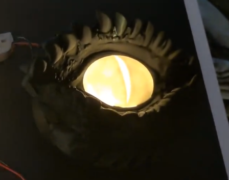
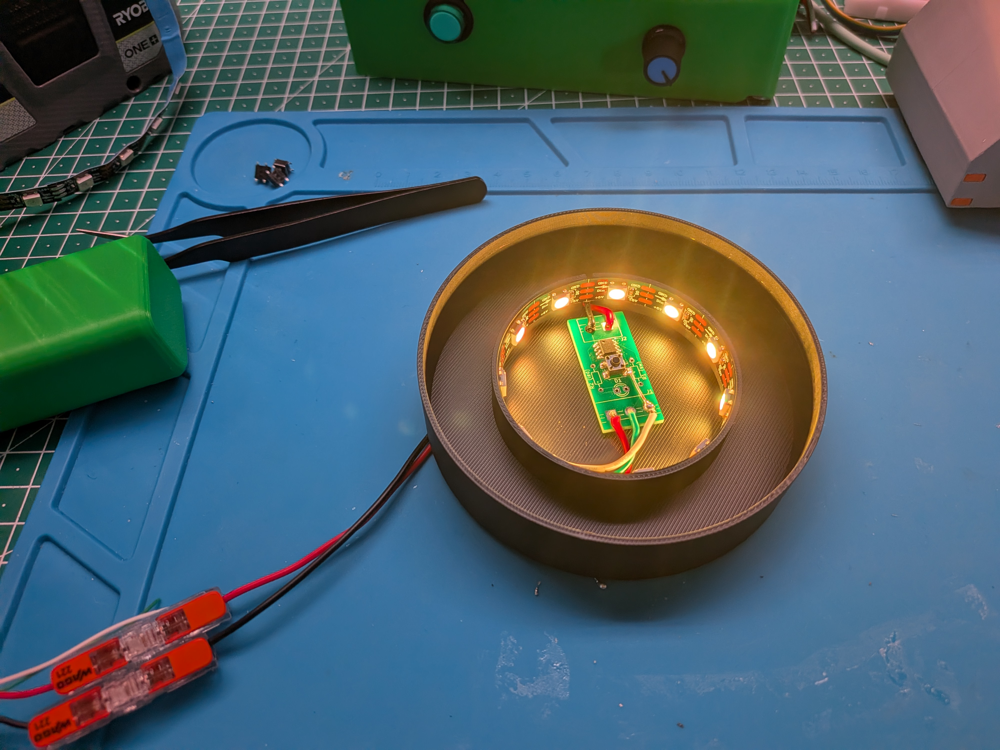
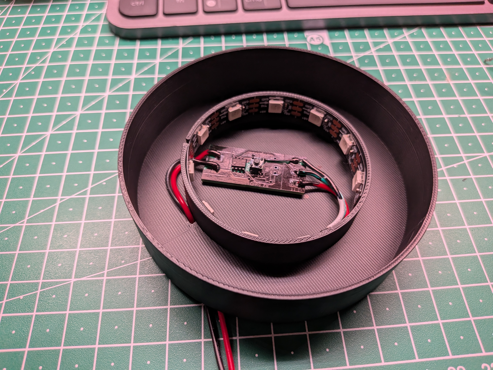
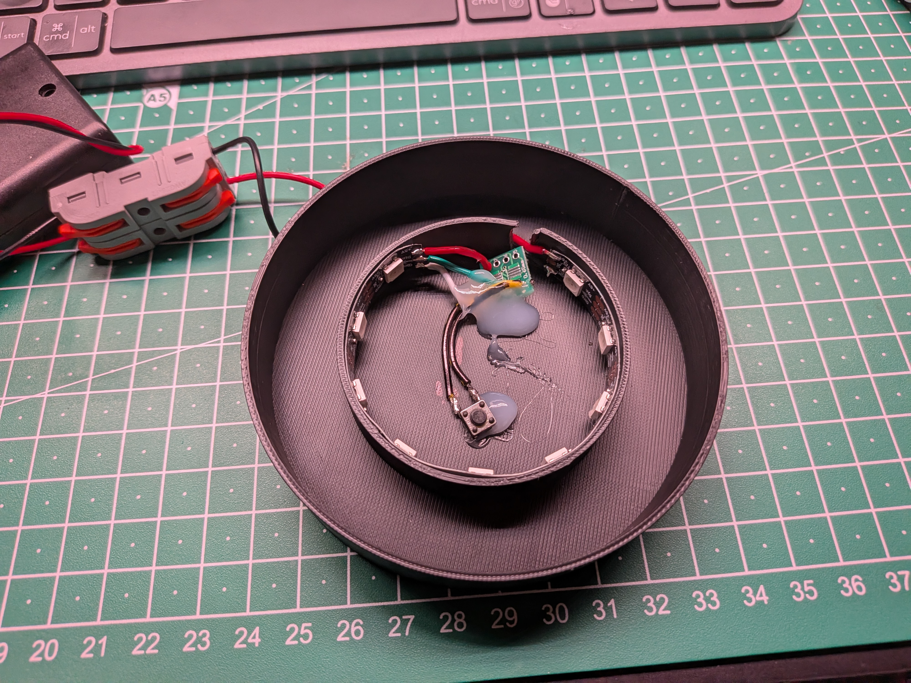

# Monster eye

This will hold more details on the Monster eye.

Artifacts:
- The simple ESP32 code [Sketch](Dragon_Eye/Dragon_Eye.ino)
- 3-D Model on [Maker World](https://makerworld.com/en/models/1428108-dragon-eye-light-for-maker-s-supply-puck-light#profileId-1484523)
- LED strip holder 3D-D Model : [Maker World](https://makerworld.com/en/models/3439334-light-lit-for-dragon-eye#profileId-3921934)
- I use the Spooky eys sketch: [Spooky Eyes Readme](<Spooky eyes/README.md>)

Automatically cycles through 4 scenes:
- Breathe Scene: 10 seconds (10% to 100% brightness, 2s per pulse)
- Solid Green: 10 seconds (100% brightness)
- Breathe Scene: 10 seconds (10% to 100% brightness, 2s per pulse)
- Off (Dark): 15 seconds (Strip completely dark)

**NOTE** The new version of the Spooky Eye allow for changing colors and dimming the LEDs using a Active low button on pin5
**RECOMMENDATION** Use a black Sharpie to paint anything that sits in the middle, so it can not be seen through the opening in the eye

